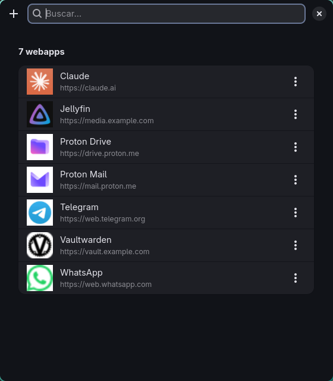

# webapp-gui

[English](README.md)

Convierte webs en aplicaciones de escritorio en Linux. Cada webapp tiene su
propia entrada en el lanzador, su propio icono (descargado de la web) y su
propia ventana de navegador en modo app, sin pestañas ni barra de direcciones.

Es una pequeña aplicación GTK4/libadwaita con modo de línea de comandos. Todo
lo que crea son archivos `.desktop` normales, así que las webapps aparecen en
cualquier lanzador o menú de aplicaciones, uses el escritorio que uses.



## Funciones

- **Añadir, editar y eliminar** webapps desde una sola ventana, con buscador.
- **Navegador a elegir para cada webapp.** Sirve cualquier navegador basado en
  Chromium que tengas instalado (Chromium, Chrome, Brave, Vivaldi, Edge,
  Helium, Thorium…).
- **Icono automático.** Prueba el `apple-touch-icon` de la web, los iconos que
  declara en su HTML, los servicios de favicons de Google y DuckDuckGo y, por
  último, `/favicon.ico`. También puedes elegir una imagen tuya.
- **Una clase de ventana por webapp** (`StartupWMClass=webapp-<nombre>`), así
  cada una sale con su icono en el dock o la barra de tareas y puedes crearle
  reglas en tu compositor.
- **Modo de línea de comandos** para scripts y dotfiles.

## Requisitos

- Python 3.10 o posterior, con PyGObject
- GTK 4 y libadwaita 1.5 o posterior
- `gtk-launch` (de GTK 3) para abrir las webapps
- Un navegador basado en Chromium. Firefox no tiene modo `--app`, así que no
  sirve.
- Opcional: ImageMagick (`magick`) para convertir iconos `.ico` y SVG a PNG, y
  `update-desktop-database` (desktop-file-utils) para refrescar la caché del
  menú.

En Arch Linux:

```sh
sudo pacman -S python-gobject gtk4 libadwaita gtk3 imagemagick desktop-file-utils
```

## Instalación

```sh
git clone https://github.com/gitgxldf1sh/webapp-gui.git
cd webapp-gui
install -Dm755 webapp-gui ~/.local/bin/webapp-gui
install -Dm644 io.github.gitgxldf1sh.WebappGui.desktop \
  ~/.local/share/applications/io.github.gitgxldf1sh.WebappGui.desktop
```

Comprueba que `~/.local/bin` está en tu `PATH`.

## Uso

Ejecuta `webapp-gui` (o abre **Webapps** desde tu lanzador).

- **+** o `Ctrl+N` añade una webapp. `Ctrl+F` busca, y `Esc` borra la búsqueda
  o cierra la ventana.
- Pulsa en una webapp para abrirla. El gestor se cierra a la vez.
- El botón **⋮** (o el clic derecho) abre un menú con **Abrir sin cerrar**,
  **Editar** y **Eliminar**.

### Línea de comandos

```sh
webapp-gui list
webapp-gui add NOMBRE URL [-b NAVEGADOR] [-i ICONO] [-f]
webapp-gui remove NOMBRE
```

`-i` admite la ruta de una imagen o el nombre de un icono del tema. `-f`
sobrescribe una webapp que ya tenga ese nombre. Sin `-b`, se usa el primer
navegador instalado de la lista del script.

## Idioma

La interfaz usa el idioma del sistema. Está en inglés y en español, y con
cualquier otro idioma sale en inglés. Para forzar uno:

```sh
LANGUAGE=es webapp-gui
```

Las traducciones están en un diccionario al principio del script. Para añadir
un idioma, copia el diccionario `ES`, tradúcelo y regístralo en
`TRANSLATIONS`. Los pull requests son bienvenidos.

## Dónde se guarda todo

| Qué | Dónde |
| --- | --- |
| Lanzadores | `~/.local/share/applications/webapp-<nombre>.desktop` |
| Iconos | `~/.local/share/icons/webapps/` |

Se respeta `XDG_DATA_HOME`. Solo se listan o tocan los archivos que empiezan
por `webapp-`. Cada webapp también se puede abrir con
`gtk-launch webapp-<nombre>`.

La URL y el navegador se guardan en el propio `.desktop` (`X-WebApp-URL`,
`X-WebApp-Browser`). Si borras un lanzador a mano, la webapp desaparece sin
dejar nada más.

## Privacidad

Para buscar el icono se hace una petición a la propia web. Si no hay suerte,
el dominio se envía a los servicios de favicons de Google y DuckDuckGo. Si no
quieres eso, elige un icono local.

## Gestores de ventanas en mosaico

En un compositor en mosaico, la ventana del gestor se coloca en mosaico como
cualquier otra. Para que flote centrada, crea reglas para su clase
`io.github.gitgxldf1sh.WebappGui`. Por ejemplo, en Hyprland (la sintaxis
exacta depende de tu versión):

```ini
windowrule = float, class:^(io\.github\.gitgxldf1sh\.WebappGui)$
windowrule = center, class:^(io\.github\.gitgxldf1sh\.WebappGui)$
windowrule = size 560 640, class:^(io\.github\.gitgxldf1sh\.WebappGui)$
```

## Licencia

[MIT](LICENSE)
