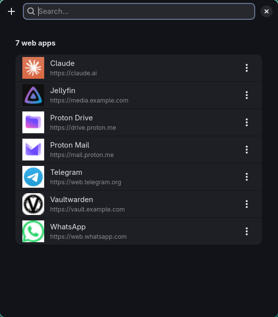

# webapp-gui

[Español](README.es.md)

Turn websites into desktop apps on Linux. Each web app gets its own launcher
entry, its own icon (fetched from the site) and its own browser app window,
with no tabs or URL bar.

It is a small GTK4/libadwaita app with a command line mode. Everything it
creates is a plain `.desktop` file, so the apps show up in any launcher or
application menu, whatever your desktop.



## Features

- **Add, edit and remove** web apps from one window, with search.
- **Choose the browser per app.** Any installed Chromium-based browser can be
  used (Chromium, Chrome, Brave, Vivaldi, Edge, Helium, Thorium…).
- **Automatic icon.** It tries the site's `apple-touch-icon`, the icons
  declared in its HTML, then Google's and DuckDuckGo's favicon services, and
  finally `/favicon.ico`. You can also pick a local image instead.
- **One window class per app** (`StartupWMClass=webapp-<name>`), so each web
  app gets its own icon in docks and taskbars, and you can write compositor
  rules for it.
- **Command line mode** for scripts and dotfiles.

## Requirements

- Python 3.10 or newer, with PyGObject
- GTK 4 and libadwaita 1.5 or newer
- `gtk-launch` (from GTK 3) to open the apps
- A Chromium-based browser. Firefox has no `--app` mode, so it is not
  supported.
- Optional: ImageMagick (`magick`) to convert `.ico` and SVG icons to PNG, and
  `update-desktop-database` (desktop-file-utils) to refresh the menu cache.

On Arch Linux:

```sh
sudo pacman -S python-gobject gtk4 libadwaita gtk3 imagemagick desktop-file-utils
```

## Install

```sh
git clone https://github.com/gitgxldf1sh/webapp-gui.git
cd webapp-gui
install -Dm755 webapp-gui ~/.local/bin/webapp-gui
install -Dm644 io.github.gitgxldf1sh.WebappGui.desktop \
  ~/.local/share/applications/io.github.gitgxldf1sh.WebappGui.desktop
```

Make sure `~/.local/bin` is in your `PATH`.

## Usage

Run `webapp-gui` (or open **Webapps** from your launcher).

- **+** or `Ctrl+N` adds a web app. `Ctrl+F` searches, and `Esc` clears the
  search or closes the window.
- Click a web app to open it. This also closes the manager.
- The **⋮** button (or a right-click) opens a menu with **Open without
  closing**, **Edit** and **Delete**.

### Command line

```sh
webapp-gui list
webapp-gui add NAME URL [-b BROWSER] [-i ICON] [-f]
webapp-gui remove NAME
```

`-i` takes an image path or an icon theme name. `-f` overwrites an existing
web app with the same name. Without `-b`, the first installed browser from the
list in the script is used.

## Language

The interface follows your system language. English and Spanish are
available, and any other language falls back to English. To force one:

```sh
LANGUAGE=en webapp-gui
```

Translations live in a dictionary at the top of the script. To add a
language, copy the `ES` dictionary, translate it and register it in
`TRANSLATIONS`. Pull requests are welcome.

## Where things are stored

| What | Where |
| --- | --- |
| Launchers | `~/.local/share/applications/webapp-<name>.desktop` |
| Icons | `~/.local/share/icons/webapps/` |

`XDG_DATA_HOME` is respected. Only files starting with `webapp-` are listed or
touched. Each web app can also be opened with `gtk-launch webapp-<name>`.

The URL and the browser are stored in the `.desktop` file itself
(`X-WebApp-URL`, `X-WebApp-Browser`). Delete a launcher by hand and it is
gone, with nothing else left behind.

## Privacy

To find an icon, the site is requested once. If that fails, the domain is sent
to Google's and DuckDuckGo's favicon services. Choose a local icon if you don't
want that.

## Tiling window managers

On a tiling compositor the manager window is tiled like any other. To float it
in the center instead, match its class `io.github.gitgxldf1sh.WebappGui`. For
example, in Hyprland (the exact syntax depends on your Hyprland version):

```ini
windowrule = float, class:^(io\.github\.gitgxldf1sh\.WebappGui)$
windowrule = center, class:^(io\.github\.gitgxldf1sh\.WebappGui)$
windowrule = size 560 640, class:^(io\.github\.gitgxldf1sh\.WebappGui)$
```

## License

[MIT](LICENSE)
